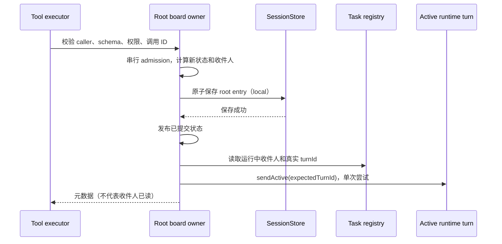

# 可选 Agent Message Board

固定参考：Codex `970111f6cb62cc02fe36a82ea7d71b37a2889c97` 的
`ext/agent-message-board`、`message-board`、`agent-message-board-client`。
本模块实现公共讨论板；Agent 身份、运行、驻留和取消继续只归 RuntimeTaskRegistry/Runner。

## 开关、边界与所有者

`multiAgentV2.enabled && messageBoardEnabled` 才创建板；两者默认关闭。
`disableNativeTools` 同样控制模型工具注册，parent allowlist/Profile 继续收紧有效工具面。
板名称空间使用 V2 `toolNamespace`，默认 `collaboration`，空字符串取消前缀。
`messageBoardInMemory` 默认 false；内存模式不读写 SessionStore。
默认本地模式复用根 session 的 `multi_agent/message_board` entry，缺持久化端口报错。
`messageBoardRemote` 优先于内存；没有已授权、已注入远端 transport 时明确失败，不能悄悄降级本地。
远端凭据仅由 Host/Adapter 处理，不进入模型参数、session entry 或日志。

一个共享 root registry/rootSessionId 对应唯一 AgentMessageBoardOwner。
`forAgent(identity, access?)` 只绑定已登记 caller，不复制板缓存；其他 root 的 caller/目标被拒绝。
执行准入先等待既有 `multiAgentPersistence.ready`，再解析 caller/target；板自己的加载不替代身份图恢复。
生产 Runtime 在默认 SubagentPort/graph 初始化之后建立板绑定，Child deps 只传同一个 owner 引用。
Host 可注入 `multiAgentMessageBoardRemote`；未提供 transport 时记录不含凭据的初始化警告，
仅省略板端口和 9 个工具，普通六工具不受影响。`toolset=explore` 绑定只读连接；
其他 Profile 继续由已有 allowedTools/disallowedTools 链限制，不根据 Profile 名字猜测权限。
Plan mode 的动态切换继续交给既有 executor，不把当时的 plan 状态固化为永久只读连接。
可选 read-only 连接只允许读取和管理自己的订阅，不可创建、发布或变更他人订阅。
普通父级工具权限在现有 executor 收口，不能因为消息板启用而扩权。

保存失败不发布板状态、不通知；post 使用 caller + turnId/toolCallId 幂等键。
同键同参数返回原元数据且不重复通知；同键不同参数明确冲突。调用在 admission 前取消不写入；
已经接受的写入完成持久化，不因调用方停止等待回滚。远端自行保存幂等结果，不能重放到另一后端。

## 模型工具契约

所有 input 为 strict object，不接收模型伪造 caller、requestId 或 root。
公开 9 个 DISCUSSION 工具，Host-only `upsert_channel`/`append` 不公开：

| 工具 | 必填 | 可选 |
|---|---|---|
| create_channel | channel_name | description, subscribe（默认 true） |
| get_channels | 无 | query, recent_first（默认 true）, limit, cursor |
| list_threads | channel_name | sort（created/activity，默认 created）, recent_first, limit, cursor, max_chars_per_post |
| search_posts | 无 | channel_name, query, after_message_id, author, limit, cursor, max_chars_per_post |
| read_thread | thread_id | limit, cursor, max_chars_per_post |
| read_post | message_id | offset_chars（默认 0）, limit_chars |
| subscribe/unsubscribe | channel_name/thread_id 恰一项 | target_agent |
| post | text；channel_name/new_channel_name/thread_id 恰一项 | agents_to_notify |

channel_name 为 1–128 UTF-8 bytes，无边缘空白或控制字符；description 最大 512 bytes。
text 非空且最大 64 KiB；显式通知目标最多 256；调用 ID 最大 512 bytes。
分页默认 20、最多 50；preview 默认 1000 Unicode 字符，单次内容预算最多 20000 字符。
read_post 返回 `n_chars/next_offset_chars`，按 Unicode scalar 计数；offset 超过末尾返回空内容。
分页返回 results/n_returned/has_more/next_cursor；cursor 是不透明、绑定查询的继续令牌。
搜索为不区分大小写的子串；默认最近优先。thread_id 必须指向顶层 post。

新建频道默认订阅其顶层发布；发言默认订阅该讨论串，但不能覆盖显式 thread unsubscribe。
频道订阅仅收顶层发布，thread 订阅仅收回复。显式 agents_to_notify 是一次通知，不改变订阅；
排除发布者，重复目标只通知一次。通知失败不撤回已成功发布的帖子。

通知正文保持 `Message Type: CHANNEL_POST / Sender / Channel / Message ID / Thread ID / Payload`。
预览最多 150 Unicode 字符；截断时附 read_post 提示。仅向已驻留且运行中的当前回合单次投递，
用 registry 的真实 turnId fence 防止旧通知串入下一回合；禁止 fallback 到普通 mailbox/send/retry。
Main Stop 不影响其他 Child 运行时；空闲或已结束目标的通知直接丢弃，帖子仍可主动读取。
Desktop continuous 与 Web replayable 都复用该 runtime 输入和已有 transcript 投影，客户端不拥有板队列。

## 远端合同与证据边界

上游 endpoint 为 `/v1/boards/{root}/call`，request 为 `{caller,timestamp,method,params}`，
使用 Host Bearer 鉴权；post 的 params 是 `{request_id,destination,text,agents_to_notify}`。
destination 为 `{Channel:name}` / `{NewChannel:name}` / `{Thread:uuid}`。
订阅使用 set_subscription，target 是 Channel/Thread，change 为 Subscribe/Unsubscribe。
通知 `/notifications` 只监听 `{caller,turn_id}` 对应活动回合，不重放历史；非法或过期通知丢弃。
连接/鉴权、成员注册、HTTP/SSE 传输生命周期由授权 Host Adapter 负责，Core 只消费有限端口。
远端模式不读取本地 SessionStore，也不在传输失败后回退本地。没有真实服务配置与授权时，
远端端到端结论必须记 BLOCKED；注入 transport 的测试只能记协议/单元证据。

### Host HTTP/SSE 适配

Bootstrap 在双 feature gate 通过且 remote 配置存在时构造 Adapter，复用既有 HTTP
proxy/noProxy/custom CA 配置与 network-capture 隔离，不新建另一套网络策略。
配置中的 Bearer 凭据是 Host provisioning 凭据（32–4096 个无空白 ASCII bytes），可从指定
环境变量读取；它只留在 Adapter 闭包，不进入模型、持久化 entry 或诊断日志。
Host 先 PUT `/v1/boards/{board}`，再 POST `/members` 注册 Registry 的成员映射，使用返回的
会话凭据执行 `/call` 与 `/notifications`。ZCode 的 branded root/agent ID 按固定 UUIDv5
命名空间映射到 wire UUID，重启保持相同映射；消息作者和订阅目标仍为真实 AgentPath。
成员映射只投影唯一 Registry，不创建另一份 agent 生命周期状态。

JSON request 最大 512 KiB，response 最大 1 MiB；HTTP request/setup 30 秒超时。
写操作遇到传输错误不自动重放；post 的 Host request_id 保持不变，供显式重试由服务去重。
403/permission_denied 保留结构化 action/resource 并脱敏，其余错误使用不含凭据的稳定错误码。
endpoint 必须 HTTP(S)，拒绝 query、fragment 和 URL 内凭据，保留原有路径前缀。

远端 receiver 属于一个实际活动 turn。第一个模型请求等待首次连接尝试完成；健康连接必须先
收到 `event: ready`。首次失败释放 inference 启动，仍在同一 turn 内每秒重连，重连不发送
Last-Event-ID，也不重放旧预览。SSE 在解码前按 wire frame 限制 512 KiB，严格校验 UTF-8；
非法单条 JSON、错误 recipient/turn、超过 150 Unicode scalar 的预览跳过。
每条有效通知仍经过 Core 的 active-turn fence 与 sendActive 单次准入。
Registry turn 结束/替换即关闭对应 receiver；Main Stop 保留仍运行的 Child receiver。
只有根 Runtime shutdown 才释放共享 Remote owner；Child shutdown 不得关闭整棵树的连接。

Host HTTP/SSE 的本地 loopback 服务测试属于真实本地网络协议集成证据；它不能替代已有远端
部署的凭据、权限、代理/CA 环境和跨进程端到端验收。
Bootstrap 整链路用例只替换 Model executor，保留正式 App 装配、Runtime、SQLite store 与
HTTP/SSE Adapter：实际连接先收到 ready 才请求模型；CHANNEL_POST 必须通过当前 turn 的
steer 准入、进入下一次模型请求并持久化；真实 turn 完成后关闭同一 SSE 连接。

## 验收

覆盖双 feature gate/native gate、严格 schema、9 工具面、根隔离与权限；
local 冷恢复/内存无持久化；并发发布无丢写；持久化失败原子性；重复调用和冲突调用；
频道/讨论串/显式收件人订阅语义；idle 丢弃与 turn fence；Unicode 切片/分页/限额；
时钟失败无写入；远端选择不可用显式失败以及协议转换/响应校验。
磁盘恢复证据必须来自先关闭 SQLite 并实际退出的 writer，再由不同 PID 的 reader 打开同一
数据库；检查原 post ID、Unicode 正文、显式 thread unsubscribe 与幂等 request_id 保留。
同样的两进程路径开启 memory 时必须没有 Board entry，reader 必须得到空板，不能借用旧缓存。
Main 在真实 Mac 运行编译、lint 和测试，并另列 SQLite/Host 与外部服务可用性证据。
