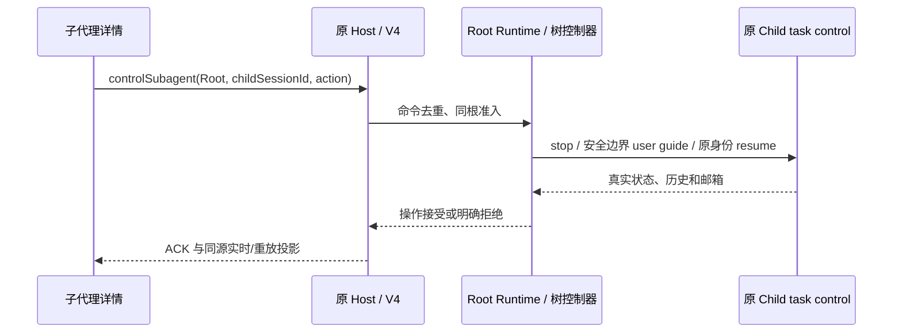
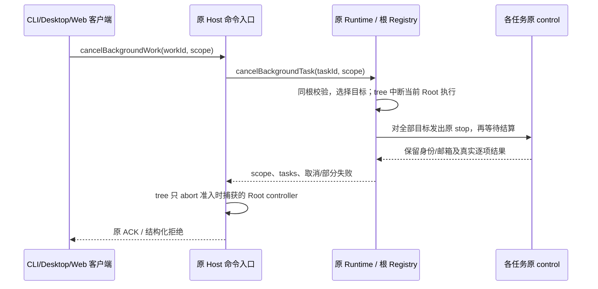

# Multi-Agent V2 模型上下文与原生客户端契约

## 唯一事实来源

代理身份、父子关系、执行/驻留状态和邮箱归现有 Core 树控制器及 Session Store。ContextBuilder、Host 投影、TUI 和 Desktop 只消费这些事实；不创建第二套队列或会话数据库。默认关闭 V2 时保持既有提示词和客户端协议行为。

## 模型上下文

Runtime 根据当前有效工具目录和身份构造 multiAgent 上下文；Root、Child、Grandchild 共用同一 section 构造函数，Child 保留原始 Profile prompt。稳定协作规则与角色规范分离于 agentPath、parentPath、rootSessionId、委派模式及当前工具列表；不将邮箱或任务正文加入稳定前缀。

工具说明只列实际注册且允许调用的完整名字。命名空间可配置。spawn 是异步接受，all/none 只决定合法模型可见历史；send 是 QueueOnly，followup 是 TriggerTurn；wait 是邮箱/完成/用户输入活动通知，不等同于读取结果；interrupt 保留身份，不等同于删除或 Stop All。只说明实际可用操作，关闭/隐藏操作不能出现幽灵能力。

NEW_TASK、MESSAGE、FINAL_ANSWER 携带 Runtime 的真实来源及任务路径。普通消息是协作数据，不能提升为 system/developer 权限；被接受、被投递与真正完成分别说明。最终结果由 Runtime 回送父级，不能依赖模型自称通知成功。

explicit 模式仅在用户明确要求委派时派生；proactive 模式按用户已授权范围做独立、边界明确的平行工作。两个模式都遵守当前实际容量和权限，不改变 Profile、AGENTS、Skills、system/developer/meta-user 的来源优先级。customSystemPrompt 保留原文；workflowActor 与 customSystemPrompt 继续互斥。

## 原生状态投影

Core 事件/Session metadata → 现有 Host 查询和 V4 snapshot → CLI/Desktop 目录与状态行。

规范 agentPath、parentAgentPath、rootSessionId、实际 parentSessionId 由 Core 写入。客户端按真实路径/父关系显示层级，进入孙代理详情时使用其真实父会话，不强行使用当前根会话。模型/effort、running/waiting/blocked/终态、耗时和使用量只显示已提供事实；字段未知时不填造值。既有 childSessionId 为稳定 key，路径仅显示和寻址。

异步 spawn 的 launch ACK 完成不代表 Child 完成。Child 初始化产生 idle projection、尚未进入首个 TurnStarted 时，保留已接受任务的运行投影；真实完成、失败或取消通知优先，不能将已结束任务重新显示为运行中。回归用例位于 `bootstrap/tests/subagent-session-query.test.ts`。

桌面 continuous 与手机 replayable 消费同一 Host owner 的序号和快照；刷新不重建已接受任务。Main Stop 的范围仍为 Main 当前 turn，显式 Agent/整树停止由 Core 准入；UI 不从窗口关闭推断子任务完成。

Root 会话实际关闭时，先通过各子孙原控制器发出停止，再关闭共享执行资源；状态及邮箱完成结算后关闭会话存储。子代理结束或单独停止不关闭其后代，普通 Main Stop 也不关闭 Root 会话。

## 子代理详情的用户控制（2026-10-27 用户确认）

详情 transcript 继续只读；底部复用产品表单组件提供“暂停子代理”和新提示词输入，Desktop 与手机消费同一命令。
V4 `controlSubagent` 的 envelope.sessionId 为原 Root；payload 为
`{action:"stop",childSessionId}` 或 `{action:"send",childSessionId,text}`。
只允许 Root 对同根非 Root 目标操作；关闭 V2、未知/跨根 child、无原控制器均结构化拒绝。
运行中输入进入该目标的安全边界指导；空闲/已停时恢复原 agentId/childSessionId/真实 parentSessionId，
沿用原模型、权限和历史，不新建独立会话或新路径。发送失败保留草稿；暂停不波及孙代理或兄弟。
普通 child sendText/legacy session/send 的只读防护保留，用户控制不借用模型 Agent 工具伪装成新的委派。

V2 MESSAGE/FINAL_ANSWER 只排队，不强制延长最终文本已收口的 Main；下一次合法请求消费并确认原邮箱。
真实用户指导和 NEW_TASK 与普通邮件分开。显式中断只产生状态活动，不作为最终答案回投模型。
Main Stop 的旧 Agent 工具取消记录仅能证明前台等待结束；子代理终态必须查询原 Registry，不能据该记录擅自停子。

## 验证

### 显式取消范围（2026-10-27）

既有 `session/cancelBackgroundTask {sessionId,taskId,scope?}` 与 V4
`cancelBackgroundWork {workId,scope?}` 共用 App/Runtime 入口。scope 缺省或 task 保持原行为；
subtree 包含目标及其规范路径下全部后代；tree 只由 Root 发起，停止同根全部子孙与 Root 当前轮。
taskId/workId 仍是已有稳定任务 ID，用作同根成员准入锚点；跨根或无效锚点不产生取消副作用。
这两个显式范围只作用于 Multi-Agent V2，不改变 Bash/Workflow 的原单任务取消。

批量回执增加可选 scope、tasks；顶层 taskId/status 保持锚点语义，cancelled 表示至少一个
选定执行被取消。tasks 逐项报告 cancelled/status/reason，实际中断的 Root 也记录在内。
部分停止/结算失败报告 `background_task_cancel_partial`，不冒充整批成功；已终态成员不重复执行。
所有中断走原 generation fence，保留原身份供后续恢复。老 App 未确认新增 scope 时拒绝，禁止
静默降成单任务取消。普通 Main Stop 继续只停止当前 Main 轮；尚无原生 UI 验收证据不能标 T17 全部通过。

- 原有 ContextBuilder 和 subagent prompt 请求组装回归。
- Root、Child/Grandchild、自定义 Profile、工具门控/namespace、委派模式、稳定前缀、custom/workflow 互斥。
- Host 查询和协议 schema 保留路径及真实 parent，UI/TUI 按层级显示且没有伪造终态。
- 原生四层树/Main Stop/冷恢复场景以 1440×900 内容区执行，执行机的可用工作区应能容纳该内容区，继续使用共享 helper 精确核对实际尺寸。
- 状态面板展开的 E2E 门禁按运行条目及分组展开状态判断；V2 运行代理行可没有传统后台任务 controlWorkId。停止控件用例仍单独校验真实任务控制 ID，不能用“有条目”替代可取消性断言。
- 单元/集成结果与真实 Provider/E2E 分开记账。S-T01～S-T12 和 T28 只有对应实测证据完整时才可判 PASS。
