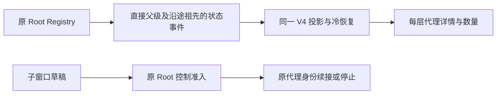

# Subagent Session Side Tabs

## 目标

本页维护当前工作树的 child 详情呈现与用户控制边界；CLI 执行/消息权威规则见
[Subagent Tool 的适用模式](../apps/zcode-cli/docs/design/v2/tool/07-subagent.md#当前适用模式与复用边界)，
运行和真实模型/桌面证据统一见[既有验收记录](../apps/zcode-cli/docs/design/v2/tool/07-subagent-v2-acceptance.md)。
原版已提供代理目录、右侧 child tab、完整只读时间线及 SessionDataLayer 订阅，V2 在其上增强昵称、
递归详情/数量与用户控制，不建立第二个会话、消息队列或树 Owner。
原 Root Registry 持有代理关系与状态，SessionStore 持有历史；Renderer 只保留草稿、打开/关闭、激活和布局状态。
Workflow activity 和正式问答继续沿原 Workflow 链路，本页输入区的普通 V2 提问/回答只是消息，
不创建 qid、待回答或阻塞问答状态。

### 代理通信与递归详情（2026-10-27）

- 代理来信和结果沿原邮箱投递，全部保留可见，直接进入原 `WorkflowNotificationToolRow` 通知入口。V4 分发仅适配消息数据，不再单独编写接收 JSX；删除“接收消息 / 完成汇报 / 来自”自定义文案和右侧发件人。通知统一用原“消息 / 任务输出”标签、sourceLabel 名称标记、摘要、正文与背景面板，展开后保留完整正文和真实身份路径。`agentMail` 仅为 UI 输入适配，不改 Workflow wire union，不创建 qid、待回答或已回答状态；真实工作流问答仍由其真实状态决定。真实用户输入、模型上下文和邮箱消费时机不变。
- 每个代理由原 Root Registry 分配同根唯一、跨续接/恢复稳定的可读 nickname；任务路径和内部 ID 不改。名称用于目录、详情、收发消息；原始身份仅在详情中保留。
- 代理名称复用原 `subagentColors` 八色配色：同名在来信、发信目标、目录、运行列表、详情和递归标签中使用同一颜色；深浅主题使用原有对应文字色。目录标题中的任务描述不参与选色，续接、排序及刷新不重新分配颜色。颜色只辅助身份辨认，不表示运行/失败状态；名称继续可见，八色允许复用，不新增颜色设置或持久化状态。
- 名称旁的头像直接复用原 `WorkflowAgentFace` 小方脸、眼睛与减少动态效果规则；普通子代理以名称颜色填充头像，不另建头像色板或保存头像状态。来信、发信目标、Agent 摘要、目录、详情及各层标签保持同一身份色；头像为装饰，原状态文字和图标继续表达真实执行状态。原 Workflow 的九色编号规则保持不变。
- 普通代理头像缺少实时执行状态时显示中性的双眼，不把未知状态当作等待；目录及运行列表使用已有代理状态选择运行双眼、成功或失败表情，只有真实 waiting/blocked 才使用原三点等待表情。历史消息和标签不推断当前执行状态，不增加状态订阅或持久化；原 Workflow 的默认等待行为保持原义。
- 每层显示该代理全部下级的数量和运行数。生命周期由原 Root Registry 发出，原父会话及沿途祖先各接收一次状态投影；不携带聊天正文，不唤醒模型，不改变消息队列。冷恢复仍由持久父关系校验树。
- 子代理详情内可继续打开自己的下级代理，形成递归详情区域；宽面板并列显示所属代理及下级区域，窄面板进入下级并保留返回入口。输入框上方和详情右上角均有下级代理入口及运行数；不重新创建运行实例，不改变 Root 控制准入。
- “新标签页”在存在当前会话时提供“代理列表”，打开既有代理目录；空会话禁用该能力，不伪造目录。

父会话 Agent 工具块中的子智能体详情入口使用 workspace 右侧共享面板，而不是
workbench 分屏。拿到 child session 目标后，用户点击 Agent 摘要行或按 Enter/Space
直接创建或激活右侧 tab，不再先展开工具详情再点击二级按钮。每个 `childSessionId`
对应一个完整只读会话 tab，从而不受 workbench 最多 4 pane 的限制，同时保持普通
session 分屏能力不变。

适用范围：桌面端、普通 Web 和手机 `/remote` 的 child 详情入口。桌面端和普通 Web
使用右侧 tab；手机
`/remote` 复用现有右侧抽屉。原顶层子智能体目录及分页入口在桌面端和
普通 Web 提供；子详情内部的递归目录和下级数量入口也用于手机 `/remote`。此处为当前源码能力，
不代表独立完成了手机实机验收。本功能不改变 owner、lease、snapshot、
queue 或 replayable 恢复语义。




## 状态模型

```text
workspaceKey = workspaceIdentity?.trim() || workspacePath
├─ workspace 共享 tabs：Git / Browser / Code Viewer / Terminal / ...
├─ root session A
│  ├─ child A1 -> Explore project structure
│  └─ child A2 -> Analyze dependencies and config
└─ root session B
   └─ child B1 -> Explore source code features

切换父 task：
  tab 条 = workspace 共享 tabs + 当前 parent session 的 child tabs
  其他 parent 的 child tabs 继续挂载和订阅，但隐藏且不获取焦点
  切回 parent 时恢复该组顺序和最后激活项
```

- UI 显式区分 `rootSessionId`（tab 分组）、`parentSessionId`（直属 lineage）和
  `childSessionId`（详情订阅目标）。一级 child 中 root 与 parent 相同； subagent tab 的
  稳定身份为 `workspaceKey + rootSessionId + childSessionId`，重复点击只激活。
- 标题统一使用入口提供的任务 `title`：Agent 摘要行传递其可见标题，Running 面板传递
  `session/subagents` 投影标题。重复打开同一 child 时同步最新非空 title；仅在 title 为空时
  回退到本地化“子智能体”，不得再拼接 `subagentType` 或编号。
- subagent tabs 只保存在 renderer 内存，不跨刷新恢复。workspace 共享 tabs 沿用现有
  workspace 级内存语义，不改成 session 级。
- 关闭、关闭其他和关闭全部只作用于当前可见集合；其他 parent 的隐藏 child tabs 不受影响。
  最近关闭记录按 parent session 隔离。
- 所有未关闭 child tabs 保持 `SessionDataLayer` lease。相同 child 的行内预览与右侧详情复用
  数据层引用计数，不建立重复 transport subscription。

## 摘要行交互边界

```text
Agent / Task 摘要行激活（永远不展开）
├─ childSessionId + open callback 可用
│  ├─ 普通桌面 / 普通 Web -> 创建或激活右侧只读 tab
│
└─ 手机 /remote -> 创建或激活现有右侧抽屉中的只读 tab
   └─ child 尚未投影或启动前失败
   └─ 静态单行摘要；不可点击，不创建临时 tab
```

- 直开模式的整条摘要行都是一个动作入口，复用现有 focus ring，并支持鼠标、Enter 和 Space。
- 直开模式不暴露 `aria-expanded`，不显示展开箭头，也不挂载行内详情；已有 tab 再次激活只负责
  展开侧栏并聚焦该 tab，不把侧栏切回关闭状态。
- child 尚未投影时不会自动打开侧栏；目标后续到达时只切换为可点击模式，只有后续显式激活
  才打开侧栏。
- 行内 Prompt 标题旁不再保留重复的“在右侧打开”按钮。
- Agent 与 Claude Code 兼容别名 Task 使用同一规则；Workflow activity 不属于本功能。

## 对话只读详情与文件撤销例外

右侧详情复用完整 `SessionPane`/conversation projection，展示完整时间线、状态、工具卡、
文件摘要和只读 diff。详情的 conversation 能力保持只读，禁止 composer、用户手动 retry、edit、fork、
stop 和 permission/elicitation 响应；单 turn workspace-only 文件撤销是唯一显式写能力例外。
provider 自动 retry 的只读状态不属于手动 retry 操作，允许显示在当前运行 turn 底部。

详情底部另有独立的子代理用户控制区，通过原 Root 的 `controlSubagent` 命令暂停目标或提交新提示词；
不解锁 child `SessionPane` 的 composer。该区共用 Main 的聊天输入外壳、上下文用量展示和单一发送/暂停动作位：
运行且空草稿显示暂停，有非空草稿显示发送，空闲空草稿禁用发送。用量来自 child 自身的 session projection，
不展示模型、思考强度或权限选择。运行中输入沿原安全边界处理，空闲或已停时沿原身份续接；
发送失败保留草稿。手机 `/remote` 沿用 Main 的回车换行、按钮发送和防 iOS 聚焦放大字号；
桌面仍为 Enter 发送、Shift+Enter 换行，并保留输入法组合保护。
发送/暂停按钮通过 `ChatPromptEditor` 的共享纯展示组件供 Main、默认 editor 和 child 控制区复用，
只接收展示参数和动作回调，不接管草稿或命令准入。Enter 判断复用 `shouldSubmitLexicalEnter`，
Ctrl/Meta 不误触发送，Shift、IME 与手机 Enter 换行仍遵守 Main 的同一规则。
首次打开已完成 child 详情时，用量从 child 自身的事件及持久化消息恢复；
容量来自 child 自身的模型能力事实，不借用父模型，不为只读查询另建 child runtime。
完整控制链路与验收约束见
[子代理用户控制与 V2 邮箱收口](../apps/zcode-cli/docs/design/v2/tool/00-tool-change-chain.md#子代理用户控制与-v2-邮箱收口2026-10-27)。

```text
child turnHeader.actions.canRewindFiles
├─ false -> 撤销按钮 disabled；不发 query/command
└─ true  -> fileRewindPreview(childSessionId, turn target)
            ├─ unsafe/ignored -> 不写文件
            └─ safe -> applyFileRewind(childSessionId, turn target)
                       -> 恢复真实 workspace
                       -> child RewindTriggered(scope=workspace)
                       -> session_entry 持久化撤销状态
                       -> child 文件摘要显示已撤销
```

- 撤销严格沿用普通 session 的单 turn、workspace-only、all-or-nothing 语义；不撤销整个 child
  session，不裁剪或改写 child/parent 聊天历史，也不提供 reapply。
- 门禁只读取目标 child 自身的 projection/action；父 task 可以仍在运行。外部或父任务对同一文件
  的修改继续由 preview hash 安全检查判为 unsafe，不新增跨 session 父级 busy guard。
- apply 只更新 child turn 的撤销状态和真实 workspace 文件；不改写父 Agent 行、Subagent
  目录、父 task aggregate 或父 session timeline。
- child cold resume 以 `SessionResumed` 建立新的 raw event epoch；gateway 只重设 raw cursor，
  对外 transport sequence 仍保持单调，确保随后 `RewindTriggered` 不会被旧 child 高水位误判为重复。
- `readOnly` 不能被整体关闭。UI 使用显式 workspace file rewind capability 例外，避免误开放
  composer、edit/retry/fork/stop 或阻塞交互响应。

父对话不再挂载轻量 child 输出预览。前台和后台 subagent
只要存在 `childSessionId` 均可
通过摘要行打开。child 当前 projection 存在 `control.lastError` 时，只读详情直接显示紧凑
错误 notice；不为该 notice 新增 timeline row、协议字段或持久化合同。

child 详情还展示两类 child-owned 模型事实：

```text
运行中 provider retry -> snapshot.control.apiRetry -> 当前 turn 底部 x/total
fresh child 实际模型 -> ModelSelected(previousModelRef=null, modelRef=X)
                     -> model_change(undefined -> X) -> 无切换箭头的 "正在使用 X"
```

- provider retry 只活在当前 CLI/runtime 内存中；有效模型进展或 turn 终态后消失，冷启不恢复。
- 首次实际模型通过 child transcript 的 `model_change` 持久化，冷启 hydration 后仍可见。
- 公共 projection 只识别显式 `∅→X` 模型边界，不保存或判断 Subagent 专属 origin。
- Main 与 child 复用 `SessionPane -> ConversationTimeline`，不得为 child 增加第二套状态组件。
- 两类事实均不进入父 Agent 摘要卡，不改变 child 只读门禁，也不新增 parent mirror。

子详情显式继承 `rootSessionId`，下级详情留在所属子窗口的递归区域；V2 runtime 支持多级派生。
递归 UI 只保存打开/关闭和激活状态，代理关系、状态与数量仍来自原 session projection。

## 实时事件边界

问题根因：child runtime 会把 raw child event 写入 child event store，但原事件 sink 只把
部分工具活动转成 parent mirror event。UI 首次订阅 `conversation/<childSessionId>` 时能从
store hydration，后续 raw event 却没有进入 child publisher，因此内容停在打开时快照。

```text
child runtime append
├─ raw child event -> child event store
├─ raw child sink -> route by event.sessionId -> publisher(child)
└─ selected mirror -> publisher(parent)

publisher(child) -> SessionDataLayer -> inline preview + all open child tabs
publisher(parent) -> parent timeline/index/legacy delivery
```

实现必须满足：

- raw child event 进入 bootstrap sink 后，只 ingest `publisher(child)` 并立即返回；不得 bump
  parent `updatedAt`、进入 parent legacy delivery 或污染父时间线。
- 现有 selected mirror event 继续以 parent session id 走父链路。
- 运行中 child 已有 live publisher 时，subscribe/rows hydration 不得额外 cold resume；只有
  live publisher 和 session record 都不存在时才恢复历史 session。
- 已完成的历史 child 在 renderer 刷新后仍能通过父会话入口重新打开并 hydration。
- 文件摘要使用 child event log 和父 runtime 共享的 artifact reader；只读 child tab 不使用
  parent runtime 执行 rewind。
- child 完成并释放 live runtime 后，`runtime/workspace_checkpoint` session entry 必须在 cold resume
  时重建 child checkpoint event；preview/apply 继续命中 child runtime，不能只恢复轻量摘要却返回
  空的 safe/unsafe 列表。
- 高频 delta 不写生产 `info`；仅在 `debug` 记录 publisher 注册、订阅和 cold-resume 判断。

## 接口与兼容

- UI 的 `SubagentSessionSidePaneTab` 和 `OpenSubagentSideTabRequest` 携带
  `rootSessionId`、`parentSessionId`、`childSessionId`、`subagentType` 与用户可见 `title`，workspace scope 由
  App shell 注入。`subagentType` 只用于类型标签和搜索提示，不参与 tab 标题生成。
- workspace 身份与缓存 key 必须使用 `workspaceIdentity?.trim() || workspacePath`；路径执行仍
  使用 `workspacePath`，remote workspace 保留 `remoteSessionId`。
- 详情本身不新增 Agent/error wire 字段；目录使用独立只读 `session/subagents` 查询，见
  [subagent-session-directory.md](./subagent-session-directory.md)。不把业务状态下沉到 main/relay。
- desktop continuous 和现有普通 Web delivery profile 保持不变；`/remote` 只启用 child 详情
  抽屉，不启用目录。
- 恢复旧 workbench group 时移除历史只读 subagent binding；普通 session group 不迁移。

## 验收

- 同一父 task 可打开至少 6 个 child tabs，workbench pane 数不增加，重复点击不重复建 tab。
- Agent 摘要行与 Running 面板打开的 tab 均逐字使用各自权威 title；不得显示
  `Explore 1`、`general-purpose 2` 等类型加编号标题。
- 有 child 目标时，Agent/Task 摘要行的点击、Enter 和 Space 直接打开或激活详情，且不会展开
  行内
  Prompt/输出；缺少 child 目标或启动前失败时保持静态单行摘要。
- 运行中 child 在打开后持续追加 text/reasoning/tool/status，非激活和隐藏 parent 分组也不中断。
- 运行中 child 发生 provider retry 时，详情当前 turn 底部显示统一的 `x/total` 状态并在有效进展后消失；
  conversation composer 保持只读，独立用户控制区仍只走 Root `controlSubagent` 准入。
- 改动后新建 child 的首个 turn 显示实际解析模型，完整冷启后仍恢复；旧 child 不回填，Main 首轮不新增 marker。
- 切换父 task 只切换 child tab 可见组；workspace 共享 tab 不随 session 切换。
- child raw event 不改变父 topic sequence/活跃时间；parent mirror 状态仍正常更新。
- local/remote workspace identity 隔离，桌面与普通 Web 使用右侧 tab，手机 `/remote` 使用现有抽屉。
- child 已完成且文件摘要可撤销时，桌面、普通 Web 与手机 `/remote` 都能完成 safe preview/apply；
  撤销后 workspace 文件恢复且 child 摘要显示已撤销，父 task 与聊天历史保持不变。

## 冷恢复、列表隔离与用户输入准入（3.12.2）

### 远端子会话的项目目录解析

子会话不进入主任务索引，不能用 childSessionId 查询主任务项目归属来决定能否订阅。
Host 使用同一 Agent 的只读 `session/list(sessionIds)` 查询持久化类型与父子关系；
按下表确认辅助会话类型后沿父链找到主任务，再由现有项目服务校验项目、Host 和目录。
子会话未单独保存 workspace identity 时，CLI 精确 ID 查询只在 child cwd 相同且持久化父链证明
属于请求 workspace 后返回；显式的不同身份仍拒绝。普通列表继续排除 child，查询不回写身份或激活 runtime。
每个会话必须与当前 attachment 的 workspace identity 和 cwd 相符；父关系缺失、成环或跨工作区时拒绝。
普通远端主任务仍必须有项目，不按 ID 前缀或旧索引行识别子会话，不补建子会话 task 行，也不扩大目录范围。
下表的“用户输入”指直接发往该 session 的普通输入命令；V2 child 的独立控制区仍以 Root 为命令目标，
不改变该只读准入，也不将 Workflow child 纳入 V2 控制。

| 持久化类型                               | 项目解析                                 | 主列表 | 用户输入                           |
| ---------------------------------------- | ---------------------------------------- | ------ | ---------------------------------- |
| `interactive`、`fork`、`workflow_parent` | 自身任务的项目                           | 可见   | 保持原有准入                       |
| `subagent_child`、`workflow_child`       | 校验父链后使用所属主任务项目             | 隐藏   | 只读                               |
| `selection_side_chat`                    | 校验父链后使用所属主任务项目             | 隐藏   | 可聊天，保留辅助对话自己的命令限制 |
| `nested_workflow_child`                  | 按持久化工作流子会话处理；不新增创建入口 | 隐藏   | 只读                               |

2026-10-19 回归：原修复仅识别 `subagent_child`，工作流与辅助对话仍以 child ID 查项目。
项目继承与只读准入分别判断类型，不能用 `parentID` 或同一个只读开关代替；混合父链逐层校验，
即使旧 child 索引有项目也不能跳过 CLI 父链。普通 fork 可拥有自己的项目，必须在 fork 处停止继承。
辅助对话续发前保存 Recent 配置时，UI 使用侧栏记录的所属主会话查询项目，发送目标仍是 child；
不能拿未入主索引的 child 查询项目，也不能把普通会话或 fork 的 Recent 改写到父项目。

```text
桌面 continuous / 手机 replayable → 同一 Host → Agent 持久化会话类型
  ├─ 主任务 → 原项目目录校验
  └─ 子会话 → 校验持久化父链身份 → 所属主任务项目目录校验
```

父子关系只由 CLI 会话存储持有，项目归属只由 Host 项目库持有；查询不新增缓存、队列或 runtime，
冷恢复与运行中订阅使用同一路径。回归覆盖远端运行中/已完成 child、重订阅、两种 clientMode、
旧 child 索引、无项目主任务，以及父链缺失、成环和跨 workspace 的拒绝。

### 冷恢复类型与主列表隔离

根因：3.12.1 回收 detached child publisher 后，打开详情进入冷恢复；bootstrap 创建
record 时遗漏持久化 taskType，默认 interactive，sessions-index 将 child 当主任务广播。

唯一身份事实源是 Agent session store 的 taskType。冷恢复须在注册 record、发布事件之前
传入该值；runtime 与 protocol record 一致。主列表只投影 interactive、fork、workflow_parent，
不能用 parentID 是否存在代替可见性。转录缓存仍按原有终态 grace / 父会话释放规则回收。

```text
child 完成 → publisher 回收 → subscribe → 读取持久化 taskType → 注册 subagent_child record
                                                               ├─ hydrate 只读转录
                                                               ├─ 主列表不可见
                                                               └─ 用户输入准入拒绝
桌面 desktop-continuous ─ direct stream ─┐
手机 web-remote-replayable ─ snapshot/gap ┴─ 同一个 Host / Agent 身份与命令准入
```

用户发起的 sendText、retry/edit、goal 续跑等输入命令在 session_input / input_history 写入前
拒绝 subagent_child、workflow_child、nested_workflow_child；已激活 child 返回 reasonCode `guard.subagentReadOnly`，尚无独立 record 的
运行中 child 沿用既有 `proto.sessionNotFound` 拒绝，绝不为发送输入额外激活 runtime。Agent 工具正常派发 child
仍由父 runtime 驱动，不经过用户协议输入准入；workspace-only 文件撤销保留既有边界。

历史污染修复由 Host task index syncer 在 workspace 首次权威 sessions-index 基线到达后执行：
对本地已有而基线缺失的 task 分批调用只读 session/list(sessionIds)，从 Agent 持久化元数据
确认表中隐藏的辅助会话类型后，仅标记对应 task index 为不可见并清理分组/排序引用；不删除 Agent
session、message、part。查询不创建 runtime、不读取 transcript、不改变归属。远端身份必须
贯穿 workspaceIdentity / remoteSessionId，异步结果仅应用于仍有效的订阅代际；旧 Agent 不支持
显式查询、缺失 session 或查询失败时保留索引，下一次 workspace 基线再尝试。不得根据基线缺失
或 parentID 单独删除。普通 session/list 继续只返回主列表类型；显式 sessionIds 查询返回匹配
workspace 的持久化身份（含隐藏类型），单批最多 64 个，includeArchived 沿用现有含义。

完整 snapshot 同步也不得将表中隐藏类型写成主任务；对于已打开的旧污染只读子代理标签页，后端
准入仍拒绝输入。修复不新增 accepted queue、timer、owner，不改变 continuous/replayable 边界。

验收：SAT27 覆盖 warm / grace 回收 / 父释放 / 冷启动后的详情重开及列表隔离；SAT28 覆盖用户
输入被拒且没有输入落库，普通主任务、fork 和 Agent 派发正常；SAT29 覆盖历史索引污染收敛、
workspace identity 隔离、远端失败保留及原始转录保留。协议层两种 clientMode 都验证；Electron
E2E 通过真实 Agent 派发、CLI 重启、点击详情，断言只读 child 正文可见且左侧没有 child。

## 2026-10-28 复审修复边界

根会话的完整后代 manifest 用于回收同一工作区、同一 Root 下失效的孙/曾孙标签；子会话局部同步只作用于它的直接子标签，不影响兄弟、祖先或其他工作区。工作区匹配继续使用 `workspaceIdentity?.trim() || workspacePath`。冷恢复以经过有效分支、项目与真实父链校验的全树生命周期建立正式行，再派生目录；seed 不保存第二份目录权威。
